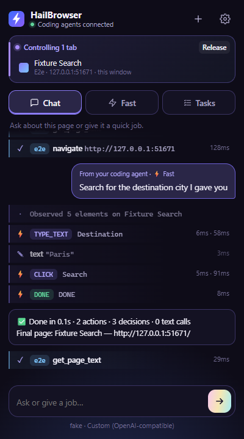

<p align="center"></p>

# HailBrowser ⚡

**An open-source browser agent that lives in your Chrome.** Chat with it in the side panel using any model you like, switch to **Ultrafast** mode for snappy form and search flows, or plug it into **Claude Code, OpenCode, Cursor, Codex** and any other MCP client so your coding agent can use your real, logged-in browser.

<p align="center"> </p>

## What you get

| | |
|---|---|
| **Side panel agent** | Chat with the current tab. Bring your own key: Anthropic, OpenAI, OpenRouter, Gemini, Together AI, Groq, DeepSeek, Ollama, LM Studio, or any OpenAI-compatible endpoint. |
| **Three modes** | **Chat**: a full tool-calling agent (read page, click, type, screenshots, JS). **⚡ Fast**: one decision request per step, no screenshots — inspired by [jev-ultrafast](https://github.com/browser-use/jev-ultrafast). **Tasks**: long jobs (finish a course, work through a list) split into subtasks with saved progress. |
| **MCP bridge** | `hailbrowser-mcp` exposes 18 browser tools to any MCP client. Several agents can share one browser at once. |
| **Real browser, real input** | Uses `chrome.debugger` for trusted mouse/keyboard events and screenshots in background tabs. No `--remote-debugging-port`, no separate Chrome profile. |
| **Visible & stoppable** | A glow shows which tab is being driven; every step appears in the side panel; one click stops a run. |

## How Tasks mode works

For jobs too long for one chat — completing a course, processing a list of pages — pick **Tasks**:

1. **Plan**: your model splits the goal into 3–15 concrete subtasks (and can add more as it discovers them, e.g. extra lessons).
2. **Work**: each subtask runs with a fresh, focused context: the overall goal, the plan with ✓ marks, and saved notes. Context never balloons, so it can keep going for hundreds of steps.
3. **Remember**: the agent saves notes (progress, URLs, answers) that carry across subtasks. Progress is stored after every step, so closing the panel or a Chrome restart just pauses it — press **Resume**.
4. **Ask**: for logins, payments, CAPTCHAs or answers it isn't sure about, it stops and asks you in the panel, then continues with your reply.
5. **Retry**: a failed subtask is retried once with the issue noted; if it fails again it asks you how to proceed (or say "skip").

Budgets (steps per subtask, total steps before checking in) are in Settings → Tasks.

## How Ultrafast works

```
page ──► indexed element table ──► ONE decision request ──► execute ──► observe
          [1] combobox "Where to?"      operation: CLICK | TYPE_TEXT | SELECT
          [2] button   "Search"                    | SCROLL | WAIT | DONE | BLOCKED
          [3] checkbox "Nonstop"        target:    an index from the table
```

The model never writes selectors, coordinates or code — it picks an **operation** and an **observed element index**. The executor re-checks that the page and target are unchanged before every input, and retries the decision (not the action) if they changed.

Three decision backends:

- **Decision API** (default) — the TypeSafe `systemone` request format used by **Jev**: operation + one speculative target head per operation, answered in a single round trip with probabilities. Point the URL/model at any compatible decision model. A small text model writes field values for `TYPE_TEXT`.
- **Letter-choice model** — small classifiers such as Together's `together/Tev1-4B-experimental` that answer one letter per question. The operation question and each operation's target question run in parallel, so a step is still one round trip.
- **Any LLM** — one JSON call per step that returns operation, target *and* the text to type. Use a fast model (Groq, Gemini Flash, Claude Haiku).

## Install

### 1. The extension

```bash
git clone https://github.com/Shyamnath-Sankar/project-hailbrowser.git
cd hailbrowser
npm install
```

Open `chrome://extensions`, turn on **Developer mode**, click **Load unpacked**, and pick the `extension/` folder. Click the toolbar icon (or press **Alt+H**) to open the side panel, then open **Settings** and add an API key.

Works in Chrome, Edge, Brave and other Chromium browsers (116+).

### 2. Connect your coding agent (optional)

Print ready-to-paste config with the absolute path of your checkout:

```bash
npm run setup
```

Then, for example:

```bash
claude mcp add hailbrowser --scope user -- node /path/to/hailbrowser/mcp-server/src/index.js
```

See [docs/connect.md](docs/connect.md) for OpenCode, Cursor, Codex, Windsurf, Gemini CLI and Claude Desktop. The side panel header turns green (**MCP connected**) once an agent has started the server.

### Coding agent + decision model (no text-model key)

The fastest setup: your coding agent (OpenCode, Claude Code…) plans, and a decision-model API drives the page.

1. In the extension's Settings → Ultrafast, pick **Decision API (Jev)** or **Letter-choice model (Tev1)** and add that key. Leave the text helper empty.
2. Your agent calls `run_task` with the goal **and the values to type**:

```json
{ "goal": "Search one-way flights for 1 adult", "mode": "ultrafast",
  "values": { "From": "Zurich", "To": "London", "Date": "2026-09-20" } }
```

The decision model picks every action and element, and also which value belongs in each field (a field named like the key, e.g. "Where to?" ↔ `To`, is matched without a call). No text-generation model is used.

Ask your agent things like *"Use hailbrowser to open my GitHub notifications and summarize them"* or *"Use hailbrowser run_task in ultrafast mode to search flights from Zurich to London on Sept 20"*.

## Tools

`tabs_context` · `tabs_create` · `tabs_select` · `tabs_close` · `navigate` · `read_page` · `find` · `get_page_text` · `screenshot` · `click` · `type` · `press_key` · `scroll` · `select_option` · `hover` · `handle_dialog` · `wait` · `javascript` · `run_task` and `stop_task` (MCP only: hand a whole goal to HailBrowser's own agent, or stop it)

Every tab HailBrowser drives joins a purple **HailBrowser** tab group (⚡ while it's working), and the side panel's *Controlling* strip shows which tab, agent and window, with one-click Show and Release. Turn grouping off in Settings → Safety.

Tool results stay honest: alerts are closed and reported, `confirm`/`prompt`/"leave site?" dialogs pause the page until `handle_dialog`, pop-up tabs are reported, `scroll` says which box moved (or that nothing could), and `type` reports when a page reformats or rejects the input. If a call times out or the agent cancels it, HailBrowser stops the action instead of finishing it later.

`read_page` returns elements like `[ref_12] textbox "Search" value="cats"`; pass `ref_12` to `click`/`type`. Screenshot coordinates also work.

## Architecture

```
Claude Code ─┐ stdio                         ┌────────── Chrome ──────────┐
OpenCode ────┼─► hailbrowser-mcp ◄──ws:127.0.0.1:12306──► service worker   │
Cursor ──────┘   (first one hosts,           │   ├─ tools (CDP + DOM)     │
                  others relay)              │   ├─ Normal agent          │
                                             │   ├─ Ultrafast agent       │
                                             │   └─ side panel UI ◄─ you  │
                                             └────────────────────────────┘
```

More in [docs/architecture.md](docs/architecture.md).

## Security model

- API keys stay in `chrome.storage.local` and go only to the provider you call.
- The MCP hub listens on `127.0.0.1` only and refuses WebSocket connections from web pages (any `Origin` other than `chrome-extension://`).
- Only one extension may drive the browser: the first HailBrowser that connects is trusted and remembered in `~/.hailbrowser/trusted-extension.json`; other extensions are rejected. After reinstalling HailBrowser from a different folder, run `npx hailbrowser-mcp trust <new id>` (or `trust --reset`). `HAILBROWSER_EXTENSION_ID` pins an ID explicitly.
- External agents can be switched off in Settings (**Allow external agents**). The `javascript` tool can be disabled separately.
- Page content is treated as untrusted data in all prompts. The agents are told never to enter passwords or payment details or complete purchases without explicit instruction.
- `chrome://` pages and the Chrome Web Store can't be automated (Chrome blocks it).

## Development

```bash
npm test                                  # syntax check + unit/integration tests (no browser, no API calls)
npx puppeteer browsers install chrome     # once
node scripts/e2e-browser.mjs              # real Chrome + extension + MCP server + scripted fake model
npm run sync-schemas                      # after editing extension/src/tools/schemas.js
```

No build step: the extension is plain ES modules; reload it in `chrome://extensions` after edits.

## Limits

Shadow DOM, cross-origin iframes, canvas apps, file uploads and pop-up windows are not fully supported yet. Ultrafast sees only on-screen elements (it scrolls to find more). Model `DONE` is a claim, not proof — verify important outcomes.

## Credits

Ultrafast's snapshot, action-space and decision-loop design is adapted from [browser-use/jev-ultrafast](https://github.com/browser-use/jev-ultrafast) (MIT). Ideas on background tabs and agent setup from [browser-use/browser-harness](https://github.com/browser-use/browser-harness) (MIT). See [THIRD_PARTY_NOTICES.md](THIRD_PARTY_NOTICES.md).

## License

MIT
